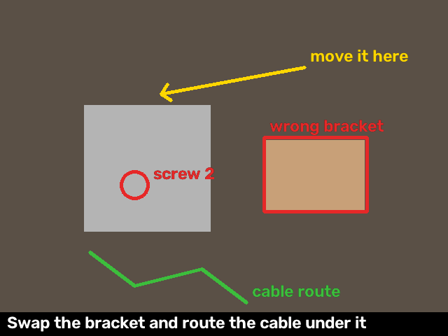

# benchsight

Let your coding agent see your workbench.

When you're wiring up a robot arm or other hardware and get stuck, the usual loop is: take a photo with your phone, move it to the laptop, paste it into Claude Code or ChatGPT, explain what you're looking at, and repeat. benchsight cuts that loop. You point the laptop camera (or a USB webcam) at the bench, and the agent takes the photo itself. It does this in the same session that already has your code, your terminal errors and the setup docs.

benchsight is an [MCP](https://modelcontextprotocol.io) server, so it works with Claude Code, Claude Desktop, Cursor and any other MCP client.

> Status: early (v0.0.1). The image tools are tested; real-camera testing on different machines is still ongoing. Object tracking and wake-up events are tested on synthetic video only, and their thresholds are not yet tuned on a real bench camera. Issues and reports are welcome.

---

## Contents

- [Set it up by pasting a prompt into your agent](#set-it-up-by-pasting-a-prompt-into-your-agent)
- [What you get](#what-you-get)
- [Requirements](#requirements)
- [Install](#install)
- [Connect it to your agent](#connect-it-to-your-agent)
  - [Claude Code](#claude-code)
  - [Claude Desktop](#claude-desktop)
  - [Cursor and other MCP clients](#cursor-and-other-mcp-clients)
- [Add the hardware-help skill (Claude Code)](#add-the-hardware-help-skill-claude-code)
- [Allow camera access](#allow-camera-access)
- [Use it](#use-it)
- [The live viewer](#the-live-viewer)
- [How tracking works](#how-tracking-works)
- [Disk space and cleanup](#disk-space-and-cleanup)
- [Settings](#settings)
- [Privacy](#privacy)
- [Troubleshooting](#troubleshooting)
- [Update and uninstall](#update-and-uninstall)
- [Develop](#develop)
- [Why this exists](#why-this-exists)
- [Roadmap](#roadmap)

---

## Set it up by pasting a prompt into your agent

The quickest way to set up benchsight is to let your coding agent do it. Copy one of these prompts into the agent and it will install benchsight, connect it and check the camera, asking you before it changes anything on your system. The manual steps are below, from [Requirements](#requirements) on, if you'd rather do it by hand.

### Claude Code

```text
Set up benchsight for me: an MCP server that lets you see my hardware workbench through
my webcam. Source: https://github.com/MNS1007/benchsight. Do these steps in order, show me
each command before you run it, and ask me before you install anything system-wide,
change any system or privacy setting, or edit files outside this project.

1. Check that Python 3.10 or newer is available (python3 --version, or python --version
   on Windows). If not, stop and tell me how to install it.
2. Run `claude mcp list`. If benchsight is already there, skip to step 5.
3. Install it so `benchsight` and `benchsight-mcp` are on my PATH:
   - if pipx is installed: pipx install git+https://github.com/MNS1007/benchsight
   - else if uv is installed: uv tool install git+https://github.com/MNS1007/benchsight
   - else ask me whether to install pipx first.
   Then check with `benchsight --help`.
4. Register the server for all my projects:
   claude mcp add --scope user benchsight -- benchsight-mcp
   If benchsight-mcp is not found from Claude Code, use its full path
   (`which benchsight-mcp`, or `where benchsight-mcp` on Windows) instead.
5. Install the hardware-help skill: shallow-clone the repo into a temporary folder
   (git clone --depth 1 https://github.com/MNS1007/benchsight <temp folder>), copy its
   skills/hardware-help folder into ~/.claude/skills/ (make the folder if needed), then
   delete the temporary clone.
6. Run `benchsight cameras`. It should print a list such as [0] or [0, 1].
   If it prints [] or fails, the camera is probably blocked: do not change any setting
   yourself. Tell me where to allow it: on macOS, System Settings > Privacy & Security >
   Camera, for the terminal app I run Claude Code in (then I must restart that app); on
   Windows, Settings > Privacy & security > Camera, with "Let desktop apps access your
   camera" on; on Linux, my user must be in the `video` group. Also tell me to close
   other apps that use the camera (Zoom, Teams, FaceTime, OBS).
7. If this folder is a git repository, offer to add `.benchsight/` to its .gitignore.
8. Finish with a short summary of what you did, and tell me to restart Claude Code so
   the new tools load. After the restart, `/mcp` should list benchsight.
```

### Cursor, Claude Desktop and other MCP clients

```text
Set up benchsight for me: an MCP server that lets you see my hardware workbench through
my webcam. Source: https://github.com/MNS1007/benchsight. Show me each command and each
config change before you make it, and ask me before you install anything system-wide,
change any system or privacy setting, or edit a config file.

1. Check that Python 3.10 or newer is available. If not, stop and tell me how to get it.
2. Install it so `benchsight` and `benchsight-mcp` are on my PATH: with pipx
   (pipx install git+https://github.com/MNS1007/benchsight) or, if I have uv,
   uv tool install git+https://github.com/MNS1007/benchsight. If I have neither, ask me
   whether to install pipx. Check with `benchsight --help`.
3. Find the full path of benchsight-mcp (`which benchsight-mcp` on macOS/Linux,
   `where benchsight-mcp` on Windows). Apps started from the dock or Start menu often
   don't see my shell's PATH, so use the full path in the config.
4. Ask me which app I use, then add benchsight to its MCP config, keeping every server
   that is already there (merge into "mcpServers"; don't overwrite the file):
     {"mcpServers": {"benchsight": {"command": "<full path to benchsight-mcp>"}}}
   - Cursor: ~/.cursor/mcp.json for all projects, or .cursor/mcp.json in this project.
   - Claude Desktop: ~/Library/Application Support/Claude/claude_desktop_config.json on
     macOS, %APPDATA%\Claude\claude_desktop_config.json on Windows (escape backslashes
     in the path, like "C:\\Users\\me\\...\\benchsight-mcp.exe").
   - Another client: find its documented MCP config file for local stdio servers and
     tell me what you will add before you add it.
5. Run `benchsight cameras`. It should print a list such as [0]. If it prints [] or
   fails, don't change settings yourself: tell me where to allow camera access for this
   app (macOS: System Settings > Privacy & Security > Camera; Windows: Settings > Privacy
   & security > Camera, with desktop apps allowed; Linux: the `video` group), and to
   close other apps using the camera. On macOS, camera permission is per app, so the
   app itself (Cursor, Claude) must be allowed, not only the terminal.
6. Optional, for Cursor: offer to save the guidance in
   https://github.com/MNS1007/benchsight/blob/main/skills/hardware-help/SKILL.md as a
   project rule, .cursor/rules/hardware-help.mdc.
7. Finish with a summary, and tell me to fully quit and restart the app so it loads the
   new server.
```

### First use

Once it's set up and restarted, point the camera at your bench and paste this (change the job to yours):

```text
I'm assembling <my SO-101 arm's gripper>. Use the benchsight tools to guide me:
1. Open the live viewer (open_viewer) and tell me where it opened.
2. Take a wide look, then zoom on whatever matters. If the photo is too dark or blurry,
   ask me to fix the light or the angle instead of guessing.
3. Track the parts you will talk about (track), with short clear labels.
4. Guide me one step at a time with annotate, anchoring each drawing to its part:
   red for wrong, green for right, a yellow arrow for where to move something, and a
   one-line caption. Check your drawings with look(with_annotations=True).
5. While I work, if you're Claude Code, run `benchsight events --follow` with your
   background Monitor tool, and look again when an event arrives instead of taking
   photos in a loop. Use objects() for quick position checks.
6. Check each step against the build docs and say which step you're on.
7. When I say I'm done: stop the Monitor, call close_viewer so the camera turns off,
   then call cleanup and tell me how much space it freed.
```

---

## What you get

Tools the agent can call:

| Tool | What it does | Inputs |
|---|---|---|
| `cameras` | Lists the cameras that work on this machine | none |
| `look` | Takes one photo now. It can zoom on a region, like a connector or a servo label | `cam` (default 0), `max_side` (default 1280), and the zoom box `x1, y1, x2, y2` as fractions 0 to 1 (default: whole frame) |
| `watch` | Takes 2 to 9 photos over a few seconds and returns them as one numbered sheet, for something that moves (a servo sweep, a cable being seated) | `cam`, `seconds` (default 6), `frames` (default 6), `max_side` (default 1600) |
| `point` | Circles a spot on the last `look` photo with a short label, to show you exactly which pin or cable it means. If the live viewer is open, the circle shows there too | `x`, `y` as fractions 0 to 1, `label` |
| `open_viewer` | Opens the **live viewer**: a small local window with the camera feed, where the agent's drawings appear on top | `cam`, `open_browser` (default true) |
| `track` | Follows parts on the live viewer. The agent names each part and boxes it on its latest `look`; benchsight then follows it frame by frame on the CPU | `objects`: a list of `{"id" (optional), "label", "box": [x1, y1, x2, y2]}`, up to 8; `replace` (default true: stop tracking parts not in the list) |
| `objects` | Where the tracked parts are now, with no image: box, status (`tracking`, `lost` or `stale`) and seconds since last seen. A cheap check instead of a new photo | none |
| `untrack` | Stops tracking parts, and removes the drawings anchored to them | `ids` (default: all) |
| `annotate` | Draws on the live viewer: arrows, circles, boxes, freehand strokes and text, plus a one-line instruction under the video. A shape with `"anchor": "<id>"` follows that tracked part | `shapes` (list), `caption`, `replace` (default true) |
| `clear_annotations` | Removes all drawings from the viewer | none |
| `close_viewer` | Closes the viewer, stops tracking and turns the camera off | none |
| `cleanup` | Deletes the photos and events file this session has saved so far, and says how much space it freed. They are deleted anyway when the session ends | none |

`look` also takes `with_annotations` (default false). With it, the agent gets the photo with its own drawings on it, so it can check they landed in the right place.

You also get:

- **`benchsight` CLI:**
  - `benchsight cameras` lists cameras.
  - `benchsight snap [--cam N] [--max-side PX]` saves one photo and prints its path. Use it with agents that don't support MCP: ask the agent to run `benchsight snap` and then open the image.
  - `benchsight events [-f/--follow] [-n LINES] [--dir DIR]` prints the tracker's recent events (a part lost or found, the scene changed, the bench went still). With `--follow` it keeps printing new ones, one JSON line each, so an agent can wake on them (see [The live viewer](#the-live-viewer)).
  - `benchsight clean [--all] [--older-than HOURS] [--dry-run] [--agent-cache] [--dir DIR]` deletes saved benchsight files (see [Disk space and cleanup](#disk-space-and-cleanup)).
- **The `hardware-help` skill for Claude Code:** it tells the agent how to use the camera well. It asks you to point the camera first, then works through these steps:
  1. take a wide shot, then zoom;
  2. check what it sees against the build docs;
  3. circle the exact part, or, on the live viewer, track the parts and draw on them;
  4. optionally wake on tracker events while you work, instead of taking photos in a loop;
  5. say when a photo can't settle the question;
  6. close the viewer and clean up at the end.
- **Playbooks:** short checklists for common builds. The first one is the LeRobot SO-101 arm.

---

## Requirements

- Python 3.10 or newer
- A camera: the built-in webcam or any USB webcam
- An MCP client, such as Claude Code, Claude Desktop or Cursor
- Windows, macOS or Linux

Check your Python version:

```bash
python --version      # Windows
python3 --version     # macOS / Linux
```

---

## Install

Pick one of three ways.

### Option A: pipx (recommended)

[pipx](https://pipx.pypa.io) installs the tool in its own environment and puts the commands on your PATH.

```bash
pipx install git+https://github.com/MNS1007/benchsight
```

Check that it installed:

```bash
benchsight --help
benchsight cameras        # should print something like [0] or [0, 1]
```

### Option B: uv, no install step

If you use [uv](https://docs.astral.sh/uv/), skip installing. Your MCP client runs benchsight straight from GitHub. See the `uvx` line under [Claude Code](#claude-code).

### Option C: from source, in a virtual environment

```bash
git clone https://github.com/MNS1007/benchsight
cd benchsight
python -m venv .venv
```

Activate the environment:

```bash
# Windows (PowerShell)
.venv\Scripts\Activate.ps1
# Windows (Git Bash)
source .venv/Scripts/activate
# macOS / Linux
source .venv/bin/activate
```

Then install:

```bash
pip install -e .
```

With this option, the command lives inside the environment. Use its full path when you connect your agent:

- Windows: `C:\path\to\benchsight\.venv\Scripts\benchsight-mcp.exe`
- macOS / Linux: `/path/to/benchsight/.venv/bin/benchsight-mcp`

---

## Connect it to your agent

### Claude Code

If you installed with pipx (Option A):

```bash
claude mcp add benchsight -- benchsight-mcp
```

With uv and no install (Option B):

```bash
claude mcp add benchsight -- uvx --from git+https://github.com/MNS1007/benchsight benchsight-mcp
```

From source (Option C), use the full path to the command:

```bash
# macOS / Linux
claude mcp add benchsight -- /path/to/benchsight/.venv/bin/benchsight-mcp
# Windows
claude mcp add benchsight -- C:\path\to\benchsight\.venv\Scripts\benchsight-mcp.exe
```

By default, the server is added for the current project only. To make it available in every project, add `--scope user`:

```bash
claude mcp add --scope user benchsight -- benchsight-mcp
```

Check it:

```bash
claude mcp list           # benchsight should show as connected
```

Inside Claude Code, `/mcp` also shows the server and its tools.

### Claude Desktop

Open the config file:

- macOS: `~/Library/Application Support/Claude/claude_desktop_config.json`
- Windows: `%APPDATA%\Claude\claude_desktop_config.json`

Add benchsight under `mcpServers`. Use the full path to the command; find it with `which benchsight-mcp` on macOS/Linux, or `where benchsight-mcp` on Windows.

```json
{
  "mcpServers": {
    "benchsight": {
      "command": "/full/path/to/benchsight-mcp"
    }
  }
}
```

On Windows, write the path with double backslashes, like `"C:\\Users\\you\\.local\\bin\\benchsight-mcp.exe"`. Then restart Claude Desktop.

### Cursor and other MCP clients

Any MCP client that can start a local command over stdio works. In Cursor, add this to `.cursor/mcp.json` in your project, or to `~/.cursor/mcp.json` to use it everywhere:

```json
{
  "mcpServers": {
    "benchsight": { "command": "benchsight-mcp" }
  }
}
```

If the client can't find `benchsight-mcp`, use its full path.

---

## Add the hardware-help skill (Claude Code)

The skill is optional, but it makes the agent use the camera much better. Copy the folder into your skills directory.

For all projects:

```bash
# macOS / Linux
mkdir -p ~/.claude/skills && cp -r skills/hardware-help ~/.claude/skills/
# Windows (PowerShell)
New-Item -ItemType Directory -Force "$HOME\.claude\skills" | Out-Null
Copy-Item -Recurse skills\hardware-help "$HOME\.claude\skills\"
```

For one project only, copy it to `<your-project>/.claude/skills/hardware-help/` instead.

If you installed with pipx or uv, you don't have the source folder. Download it from GitHub first:

```bash
git clone --depth 1 https://github.com/MNS1007/benchsight /tmp/benchsight && cp -r /tmp/benchsight/skills/hardware-help ~/.claude/skills/
```

---

## Allow camera access

Your operating system has to let the program that runs the MCP server use the camera. That program is your terminal for Claude Code, or the app itself for Claude Desktop and Cursor.

- **macOS:** System Settings > Privacy & Security > Camera, then turn it on for your terminal app (Terminal, iTerm, VS Code and so on) or for Claude / Cursor. macOS asks the first time a photo is taken; if you missed that prompt, turn it on here and restart the app.
- **Windows:** Settings > Privacy & security > Camera. Turn on "Camera access" and "Let desktop apps access your camera".
- **Linux:** your user needs access to `/dev/video*`, usually by being in the `video` group: `sudo usermod -aG video $USER`, then log out and back in.

Test it outside the agent:

```bash
benchsight snap           # prints the path of a saved photo
```

Open the printed file. If it's black or the command fails, see [Troubleshooting](#troubleshooting).

---

## Use it

1. Point the camera at the hardware. A USB webcam on a small stand or gooseneck works best, because you can aim it at the bench and keep your hands free.
2. Ask the agent in plain words. For example:
   - "My SO-101 elbow servo won't respond. I'm pointing the camera at the board, take a look."
   - "Look at the cable on servo 3 and tell me if it's fully seated."
   - "Watch the gripper while I run the calibration and tell me where it stops."
   - "Which pin does the yellow wire go to? Point at it."
3. The agent calls `look`, `watch` or `point`. Claude Code asks your permission the first time it uses each tool.
4. Pair it with the terminal. If a script just failed, say so. The agent can read the error and check whether the hardware explains it: a wrong servo ID, an unplugged cable, the wrong port.

Tips:

- **Several cameras:** `benchsight cameras` lists them. Tell the agent which one to use ("use camera 1").
- **Small parts:** ask the agent to zoom. It can crop to any region, and the crop is taken from the full-resolution frame.
- **Dark benches:** add light. A blurry or dark photo is not evidence, and the skill tells the agent to ask for a better one rather than guess.

---

## The live viewer

For step-by-step guidance, the agent can open a live view of your bench and draw on it while you work. For example: "this bracket is the wrong one", "move it here", "route the cable like this".



*The drawings shown on a test image. On a real bench they appear over the live camera.*

**How it works:**
1. Ask for it: "Open the viewer and guide me through mounting the gripper."
2. The agent calls `open_viewer`. A browser tab opens at a local address (like `http://127.0.0.1:53817/`) with the live camera. Keep it beside your bench or on a second screen.
3. When you ask "what's wrong?", the agent takes a photo, finds the problem, and draws on the live view:
   - **red** for wrong;
   - **green** for right;
   - **yellow** for where to move something;
   - a short instruction under the video.
4. The drawings stay on screen until the agent changes them, so you can keep working with both hands.
5. When you're done, the agent calls `close_viewer` and the camera turns off. Closing the tab alone does not turn the camera off.

**What the agent can draw.** Coordinates are fractions 0 to 1 of the frame, and the color is optional.

```json
{"type": "arrow",  "from": [0.7, 0.4], "to": [0.35, 0.3], "label": "move it here", "color": "yellow"}
{"type": "circle", "at": [0.3, 0.55], "r": 0.04, "label": "screw 2"}
{"type": "box",    "box": [0.59, 0.41, 0.82, 0.63], "label": "wrong bracket"}
{"type": "path",   "points": [[0.2, 0.75], [0.3, 0.85], [0.45, 0.8]], "label": "cable route", "color": "green"}
{"type": "text",   "at": [0.6, 0.6], "text": "flip it over"}
```

**Drawings that follow the part.** Ask the agent to track the parts it is talking about ("track the gripper and the bracket"). It calls `look`, decides what each part is and where, and calls `track` with a box for each. Then it adds `"anchor": "<id>"` to a shape, and the shape sticks to that part as the part or the camera moves:

```json
{"type": "box",    "box": [0.59, 0.41, 0.82, 0.63], "label": "wrong bracket", "anchor": "bracket"}
{"type": "arrow",  "from": [0.7, 0.2], "to": [0.62, 0.45], "label": "this screw first", "anchor": "bracket"}
```

- Boxes and circles follow the part and grow or shrink with it. An arrow's head follows the part and its tail keeps its offset. Paths and text move with the part's centre.
- When the part is hidden or leaves the frame, its drawings stay at its last place, **dashed and faded, with a "(lost)" tag**. When the part comes back, benchsight finds it again and the drawings snap back to it.
- Drawings without an anchor are fixed to the camera image: if you move the camera, ask the agent to look again and redraw.
- `untrack`, or a new `track` call that leaves a part out, also removes the drawings anchored to it.

**Let the agent wake when something changes (Claude Code).** Instead of taking photos in a loop, the agent can run `benchsight events --follow` with Claude Code's background **Monitor** tool. The command prints one JSON line when something happens on the bench, and each line wakes the agent, which then takes a look and redraws. Ask for it in plain words: "Guide me through mounting the gripper, and watch the bench while I work."

Each line looks like this:

```json
{"t": 1793920489.81, "time": "2026-11-05T15:14:49", "event": "object_lost", "events": [{"event": "object_lost", "id": "gripper", "label": "gripper"}], "summary": "gripper (gripper) lost"}
```

- Events: `object_lost`, `object_found`, `scene_changed` (the camera was bumped, something big moved, or the view was blocked) and `still` (the bench went calm after a burst of motion).
- Lines are debounced to about one every 5 seconds; everything in between is merged into the next line, so the agent isn't woken more often than that.
- Events are written only while the viewer is open, to `events.jsonl` in the photo folder. `benchsight events --follow` reads `./.benchsight` by default. If you set `BENCHSIGHT_DIR` for the server, the agent's shell does not see it: pass the same folder with `--dir`.
- A Monitor runs for 30 minutes at most. The agent re-arms it if the job takes longer. You can also watch the events yourself in a second terminal with the same command.

**Privacy:** the viewer is served on 127.0.0.1 only, so other devices on your network can't see it. It streams only while open.

---

## How tracking works

benchsight does not ship an object detector. **The agent is the labeller**: it already understands the photo, so it names each part and gives a rough box. benchsight's job is only to keep that box on the part afterwards, cheaply and on the CPU, while the viewer is open.

- **Trackers.** Each part gets its own OpenCV tracker. The default is **VitTrack**, a small model (one ONNX file under 1 MB) downloaded once from [opencv_zoo](https://github.com/opencv/opencv_zoo) into `~/.cache/benchsight/models` and checked against a pinned SHA-256. If the download fails or you are offline, benchsight falls back to OpenCV's **MIL** tracker, which needs no file. `track` returns the `backend` in use. No GPU, torch or onnxruntime is needed.
- **Camera motion.** If the laptop gets bumped, every part seems to move at once. benchsight estimates the whole frame's shift (sparse optical flow every frame, ORB feature matching every few frames) and moves all boxes by it before each tracker refines its own.
- **Lost and found.** A part is marked lost after 3 bad frames in a row: low tracker score, or a jump or size change that can't be real. It keeps its last box. Every few frames benchsight looks for it again, first near its last place and then in the whole frame, by matching features and then the picture of the part the agent first boxed. When found, its tracker restarts.
- **Memory.** Parts are remembered like a small scene graph. A new box with a matching label over an existing part (say "slider plate" over "white plate") updates that part instead of adding a duplicate. Shown boxes are smoothed so drawings don't jitter. A lost part fades: it is `stale` after about 30 seconds and forgotten after about 50.
- **Events.** The same camera-motion estimate, plus how much of a small thumbnail changed, drives the `scene_changed` and `still` events.

**CPU use.** While the viewer is open, the tracker follows the objects the agent asked it to track (`track`), on the CPU. It aims to stay under 0.15 of one core (`BENCHSIGHT_CPU`). When updating every object every frame would cost more, the objects take turns: each one still updates at least every 4th frame, and camera motion moves all the boxes in between. That keeps one VitTrack object at the target. With more objects, or with the offline MIL fallback, it uses more, as the table shows, but much less than without the budget. The cost of the budget: an object can wait up to 3 frames, so a hidden object is reported lost after up to about 0.8 s, and fast motion (over about 50 px/s at 640 px) is followed less closely, mostly with MIL. `BENCHSIGHT_CPU=0` updates every object every frame. Measured on an Apple M2 with OpenCV 5.0, a 640x480 feed at 15 fps, and one OpenCV thread (`python scripts/bench_tracking.py`):

| Tracker | Objects | fps | CPU, share of one core | With no budget (`--cpu 0`) |
|---|---|---|---|---|
| none tracked | 0 | 14 | 3% | 3% |
| VitTrack | 1 | 14 | 15% | 24% |
| VitTrack | 4 | 14 | 22% | 37% |
| VitTrack | 8 | 14 | 28% | 70% |
| MIL (offline fallback) | 1 | 13 | 18% | 32% |
| MIL (offline fallback) | 4 | 13 | 33% | 100%, 13.6 fps |
| MIL (offline fallback) | 8 | 10.5 | 45% | 100%, 6.8 fps |

Before the budget and the cheaper settings, the same benchmark used two to four times as much: MIL filled a whole core from 4 parts up. Run `python scripts/bench_tracking.py --help` to measure your own machine; it uses a synthetic feed and needs no camera.

**Credit:** the camera-motion estimate, the scene-graph memory and the event debouncer are adapted from VISTA (UMD Ironsite Hackathon 2025, Team Cortex).

---

## Disk space and cleanup

benchsight saves every photo, zoom, contact sheet and annotated image it sends to the agent, in the photo folder (`.benchsight/` in the folder the server starts in, or `BENCHSIGHT_DIR`). So it doesn't fill your disk:

- **When the session ends, its files are deleted.** That is when your agent closes the server, or the server exits or gets SIGTERM, SIGINT or SIGHUP. Only files this session wrote are deleted, plus the events file. Set `BENCHSIGHT_KEEP=1` to keep them.
- **24-hour backstop.** Each new photo also deletes benchsight photos older than 24 hours, in case a session was killed hard (for example with `kill -9`).
- **During a session**, the agent can call the `cleanup` tool to delete what the session has saved so far.
- **By hand**, use `benchsight clean`. Try `--dry-run` first: it only lists what would go.

```bash
benchsight clean --dry-run          # list benchsight files older than 24 h
benchsight clean                    # delete them
benchsight clean --older-than 2     # older than 2 hours
benchsight clean --all              # every benchsight file, whatever its age
benchsight clean --dir /path/to/photos
benchsight clean --agent-cache --dry-run   # also Claude Code's own copies (see below)
```

- **Claude Code keeps its own copies.** When a tool returns an image, Claude Code saves a copy under `~/.claude/projects/<project>/<session>/tool-results/` named `mcp-benchsight-blob-*`. benchsight's session cleanup does not touch these. `benchsight clean --agent-cache` deletes them, with the same 24-hour rule unless you add `--all`, so a running session's recent images stay. It also looks in `CLAUDE_CONFIG_DIR` if you set it.

What benchsight will delete is deliberately narrow, because `BENCHSIGHT_DIR` can point anywhere: only regular files directly in the photo folder, named the way benchsight names them (like `20261105-151449-812-look.jpg`), and `events.jsonl`. With `--agent-cache`, only files named `mcp-benchsight-blob-*` in a `tool-results` folder. It never deletes folders, symlinks, or other files, even ones next to its own.

One caveat: `events.jsonl` is shared by every session that uses the same photo folder. Ending one session deletes it even if another session is still writing to it. Only past lines are lost; new events keep coming.

---

## Settings

| Setting | Default | What it does |
|---|---|---|
| `BENCHSIGHT_DIR` (environment variable) | `.benchsight` in the folder the server starts in | Where photos and `events.jsonl` are saved |
| `BENCHSIGHT_KEEP` (environment variable) | unset | Set to `1` to keep this session's files when it ends. The 24-hour backstop still applies |
| `BENCHSIGHT_MODELS` (environment variable) | `~/.cache/benchsight/models` | Where the VitTrack model file is downloaded and kept |
| `cam` (tool input) | `0` | Which camera to use |
| `BENCHSIGHT_PORT` (environment variable) | random free port | Port for the live viewer, if you want a fixed address |
| `BENCHSIGHT_TRACKER` (environment variable) | `auto` | Object tracker: `auto` (VitTrack if its model is available, else MIL), `vit` or `mil` |
| `BENCHSIGHT_CPU` (environment variable) | `0.15` | Share of one core tracking aims to stay under. `0` means no limit: every object updates every frame |
| `max_side` (tool input) | 1280 (`look`, `point`), 1600 (`watch`) | Longest side of the image sent to the agent. Smaller means faster and fewer tokens |

To set one in Claude Code, add `-e NAME=value` (repeat it for more):

```bash
claude mcp add benchsight -e BENCHSIGHT_DIR=/path/to/photos -e BENCHSIGHT_TRACKER=mil -- benchsight-mcp
```

In Claude Desktop, Cursor and other clients, add an `"env": {"BENCHSIGHT_DIR": "/path/to/photos"}` entry next to `"command"`.

---

## Privacy

- **No hidden photos.** A photo is taken only when the agent calls a tool, and your client asks you before the first call. The camera stays on between photos only while the live viewer is open, until `close_viewer`.
- **No recording, also with the viewer open.** The live viewer and the tracker keep frames in memory only. They save nothing to disk except the small `events.jsonl` (event names and part labels, no images).
- **Photos stay on your machine.** They're saved in the photo folder (see [Settings](#settings)) and deleted when the session ends, or after 24 hours at the latest. See [Disk space and cleanup](#disk-space-and-cleanup).
- **Your agent may keep its own copies.** Claude Code saves each image a tool returns in its session folder under `~/.claude/projects/`. Delete those with `benchsight clean --agent-cache`.
- **Tracking runs locally.** The trackers run on your CPU. The only download is the VitTrack model file, once, from GitHub; no images are sent for it.
- **The only thing sent anywhere** is the photo the agent asked for, to the model you already use. Tracking sends nothing.
- Many webcams turn on a light while the camera is in use, so you can see when a photo is taken.

Add `.benchsight/` to your project's `.gitignore` so photos are never committed.

---

## Troubleshooting

**`benchsight-mcp: command not found`, or the client says the server failed to start**
The command isn't on the PATH the client sees. Use the full path (find it with `which benchsight-mcp` on macOS/Linux or `where benchsight-mcp` on Windows), or use the `uvx` setup.

**"camera 0 did not open"**
- Another app may be using the camera (Zoom, Teams, FaceTime, OBS). Close it.
- Camera permission may be off. See [Allow camera access](#allow-camera-access).
- The camera may have a different index. Run `benchsight cameras` and pass that number.

**The photo is black or very dark**
- Some cameras need a moment to adjust; benchsight drops the first few frames for this. Try again with more light.
- On a laptop with a privacy shutter or camera key, open the shutter or turn the camera on.

**`benchsight cameras` prints `[]`**
No camera answered. Check permissions and cables, and try unplugging and replugging a USB webcam.

**The tools don't appear in Claude Code**
Run `claude mcp list`. If benchsight shows as failed, run the same command it uses (for example `benchsight-mcp`) in a terminal to see the error. It should start and wait silently; press Ctrl+C to stop it.

**macOS: it worked in Terminal but not in Claude Desktop or Cursor**
Camera permission is per app. Turn it on for that app too.

**`open_viewer` says "Tracking is off: ..."**
The viewer still works; only `track` and anchored drawings don't. The message says why. If it's about the tracker, try `BENCHSIGHT_TRACKER=mil`.

**Tracking uses MIL, not VitTrack (the `backend` in `track`'s result)**
The model download failed, usually because you were offline. benchsight tries again the next time the viewer opens. To download it ahead of time, open the viewer once while online. To work offline on purpose, set `BENCHSIGHT_TRACKER=mil`. MIL works but is slower and less steady; see [How tracking works](#how-tracking-works).

**A part shows "(lost)" and doesn't come back**
benchsight looks for lost parts again by themselves, but a part that turned a lot, changed shape (a gripper opening) or is now under bad light may not match the picture first boxed. Ask the agent to look again and track it again; a new box with the same label updates the same part, so its drawings stay.

**Drawings lag behind fast movement**
To save CPU, parts take turns updating. Set `BENCHSIGHT_CPU=0` to update every part every frame, if your machine has CPU to spare.

**`benchsight events --follow` prints nothing**
Events are written only while the viewer is open, and only when something happens. Check that it reads the right folder: it uses `./.benchsight` unless you pass `--dir` (the server's `BENCHSIGHT_DIR` is not seen by other shells). `benchsight events` without `--follow` prints the last 20 lines.

**The photo folder is getting big**
Run `benchsight clean --dry-run` to see what is there, then `benchsight clean` (or `--all`). See [Disk space and cleanup](#disk-space-and-cleanup).

---

## Update and uninstall

```bash
# update
pipx upgrade benchsight                 # pipx
git pull && pip install -e .            # from source

# uninstall
claude mcp remove benchsight
pipx uninstall benchsight               # pipx
rm -rf ~/.claude/skills/hardware-help   # the skill, if you copied it
```

---

## Develop

```bash
git clone https://github.com/MNS1007/benchsight
cd benchsight
python -m venv .venv
source .venv/bin/activate        # Windows: .venv\Scripts\activate
pip install -e ".[test]"
pytest
```

The tests use synthetic images and video and need no camera and no network. Tests that need the VitTrack model run only if it is already downloaded; the MIL fallback is always tested.

Project layout:

```
src/benchsight/camera.py   camera access, zoom, contact sheet, point marker, local store
src/benchsight/server.py   the MCP server and its tools
src/benchsight/feed.py     the live camera feed used by the viewer
src/benchsight/overlay.py  annotation shapes, anchors, checks and drawing
src/benchsight/viewer.py   the local live-viewer web page
src/benchsight/track.py    object tracking: VitTrack/MIL, lost and found, scene memory, CPU budget
src/benchsight/motion.py   camera motion from optical flow and ORB
src/benchsight/events.py   wake-up events and their debouncer, events --follow
src/benchsight/cleanup.py  deleting saved files at session end and on demand
src/benchsight/cli.py      the benchsight CLI (snap, cameras, events, clean)
scripts/bench_tracking.py  CPU and fps benchmark for tracking (no camera)
skills/hardware-help/      the Claude Code skill
playbooks/                 checklists for specific builds
tests/                     tests (no camera, no network needed)
```

To try the server by hand, use the MCP Inspector:

```bash
npx @modelcontextprotocol/inspector benchsight-mcp
```

Contributions are welcome. New playbooks for other robots and kits are especially useful.

---

## Why this exists

Several open-source MCP servers already take a webcam snapshot. benchsight isn't trying to be another one. It adds the workflow a hardware builder needs around the camera:

- **zoom and point**, so the agent can show you where, not just tell you;
- **short sequences** for moving parts;
- **a skill** that makes the agent check its view against the build docs before answering;
- **playbooks** for common builds, starting with the LeRobot SO-101 arm.

If that layer doesn't make the agent clearly more useful than a plain snapshot tool, this project should fold into an existing one.

## Roadmap

Done:

- Live viewer with drawings that follow tracked parts, on the CPU.
- Wake-up events (`benchsight events --follow`), so the agent can react to the bench instead of polling it.
- Session-end cleanup of saved images, and `benchsight clean`.

Next:

1. Real-world testing on SO-101 builds across Windows, macOS and Linux, and tuning the event thresholds on real bench cameras.
2. Let you click or draw on the viewer to point at something for the agent.
3. A watch mode with a stop condition, for example "tell me when the servo stops jittering".
4. A small eval set of real bench mistakes (wrong servo ID, reversed cable, missing screw, wrong calibration pose), run with and without benchsight.
5. More playbooks: other arms, 3D printer setup, breadboards.
6. State-change events, such as "screw now present", after the agent re-labels a part.
7. An optional on-device open-vocabulary detector (for example YOLO-World or YOLOE as ONNX), as an extra (`pip install benchsight[detect]`), only to re-label parts. The agent stays the main labeller, and the base install stays light.
8. Coordinates that don't depend on the camera's pose (VISTA's allocentric heading and polar coordinates), for a moving camera such as one on the robot's wrist. A fixed bench camera doesn't need them.

## Credits

Camera-motion estimation, the scene-graph object memory and the event debouncer are adapted from VISTA (UMD Ironsite Hackathon 2025, Team Cortex). Object tracking uses OpenCV's VitTrack model from [opencv_zoo](https://github.com/opencv/opencv_zoo) and its MIL tracker.

## License

Not chosen yet. Until a license file is added, all rights are reserved.
